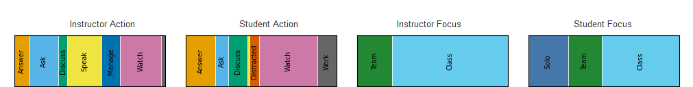
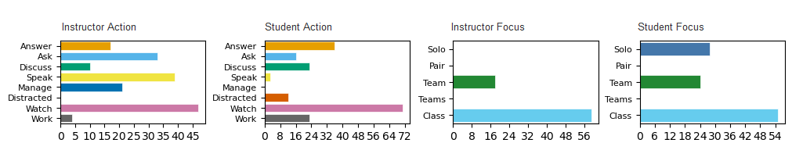
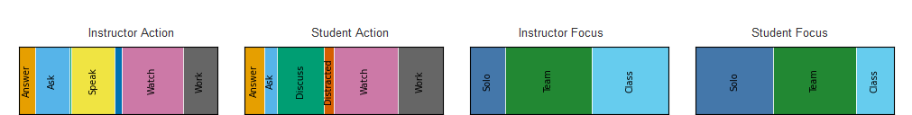
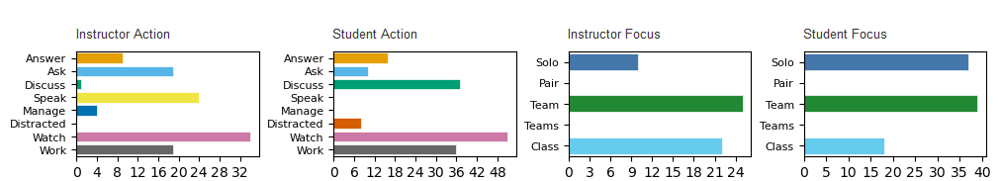

# FASTOP for Researchers

This page summarizes results from FASTOP observations of real classrooms,
and explains how FASTOP relates to other observation protocols.
For definitions of the codes, see [What are the FASTOP codes?](fastop.md#what-are-the-fastop-codes)

## What can analysis of FASTOP data show?

This table summarizes preliminary results from our 2023 ASEE paper,
based on 44 class sessions in 10 sections of 3 courses, taught by 6 instructors at 2 institutions.
Each row is a FASTOP code, grouped into student and teacher *focus*, and student and teacher *action*.
Each column is a classroom activity: traditional lecture, interactive lecture, computer laboratory, POGIL team work, and POGIL report out.

To create the table, each observed session was split into segments based on the activity.
Observers often marked more than one code in the same minute, so each code was weighted by 1/*k*,
where *k* is the number of codes marked in that minute and category.
For example, if a student was coded as both *Work* and *Discuss* in one minute, each code counted as 1/2.
The weighted codes were then averaged across instructors and classes, so each block sums to 100%.
For clarity, values <10% have been replaced with an asterisk.

Thus, in a traditional lecture, the teacher mostly *speaks* to the whole *class*,
while roughly half of students *watch/listen* and the rest are *distracted* or *work*.
In contrast, during POGIL teamwork, the teacher *watches/listens* about 40% of the time, but also *discusses*, *asks*, and *manages*,
while students *discuss* and *work* more than half of the time.

 <!-- affects mkdocs but not VSCodium preview -->

|    Focus or Action | Code         | Trad. Lecture | Inter. Lecture | Comp. Lab | POGIL Team | POGIL Report |
| -----------------: | -----------: | ------------: | -------------: | --------: | ---------: | -----------: |
|  **Student Focus** | Solo         |            41 |              * |        61 |          * |            * |
|                    | Pair         |               |                |        33 |            |              |
|                    | Team         |               |             13 |         * |         88 |            * |
|                    | Teams        |               |                |           |          * |              |
|                    | Class        |            59 |             85 |         * |          * |           98 |
|                    |              |               |                |           |            |              |
|  **Teacher Focus** | Solo         |             * |                |        58 |         18 |              |
|                    | Pair         |               |                |        23 |          * |              |
|                    | Team         |             * |              * |         * |         53 |            * |
|                    | Teams        |               |                |         * |          * |              |
|                    | Class        |            96 |             91 |        13 |         21 |           92 |
|                    |              |               |                |           |            |              |
| **Student Action** | Answer       |             * |             22 |         * |         14 |           27 |
|                    | Ask          |             * |                |         * |          * |            * |
|                    | Discuss      |               |              * |        34 |         30 |            * |
|                    | Speak        |               |                |         * |          * |            * |
|                    | Manage       |               |                |           |          * |              |
|                    | Distracted   |            24 |             13 |         * |          * |           11 |
|                    | Watch/Listen |            51 |             40 |        16 |          * |           45 |
|                    | Work         |            20 |             18 |        35 |         28 |           14 |
|                    |              |               |                |           |            |              |
| **Teacher Action** | Answer       |             * |                |        17 |          * |            * |
|                    | Ask          |             * |             31 |         * |         13 |           41 |
|                    | Discuss      |               |              * |        50 |         16 |              |
|                    | Speak        |            87 |             46 |         * |          * |           46 |
|                    | Manage       |             * |              * |         * |         12 |            * |
|                    | Distracted   |               |                |           |          * |              |
|                    | Watch/Listen |               |             13 |        17 |         40 |            * |
|                    | Work         |               |                |           |          * |              |
|                    |              |               |                |           |            |              |

The plots below show FASTOP data from two individual class sessions (not averages); courses are anonymized.
For each session, the first plot shows the proportion of each code,
and the second plot shows the number of times each code was recorded.

Actions and focus for instructors and students during an interactive lecture session:

Actions and focus for instructors and students during a POGIL session:

## How does FASTOP differ from other observation protocols?

An observation protocol embodies decisions about what will be observed.
For example, the [*Classroom Observation Protocol for Undergraduate STEM (COPUS)*](http://www.cwsei.ubc.ca/resources/tools/copus.html) focuses on practices in *Peer Instruction*.
Similarly, the [*Observation Protocol for Teaching in Interactive Classrooms (OPTIC)*](https://pogil.org/pogil-tools/optic) focuses on practices in [*Process Oriented Guided Inquiry Learning (POGIL)*](https://pogil.org) and other forms of collaborative small-group learning.

We wanted to understand what actually happens in a variety of class sessions,
including lectures, lab activities, Peer Instruction, POGIL, etc.
Specifically, we wanted to analyze *what* students and teachers did (their **action**)
and *who* they interacted with (their **focus**).
For example, students could work with a team, a partner, or alone;
the instructor could speak to a single student, a team, or the whole class.

Thus, most COPUS and OPTIC codes map to multiple FASTOP codes.
The draft mappings below show how OPTIC and COPUS codes correspond to FASTOP codes.

<!-- 
## FASTOP Codes (some abbreviated)

|     Focus |        |        |        |         |         |
|     ----: | ----   | ----   | ----   | ----    | ----    |
| *Student* | S-Solo | S-Pair | S-Team | S-Teams | S-Class |
| *Teacher* | I-Solo | I-Pair | I-Team | I-Teams | I-Class |

|    Action |          |       |           |         |          |            |          |        |
|     ----: | ----     | ----  | ----      | ----    | ----     |----        | ----     | ----   |
| *Student* | S-Answer | S-Ask | S-Discuss | S-Speak | S-Manage | S-Distract | S-Listen | S-Work |
| *Teacher* | I-Answer | I-Ask | I-Discuss | I-Speak | I-Manage | I-Distract | I-Listen | I-Work | 

-->

## OPTIC ↔ FASTOP

| OPTIC     | Classroom Interactions                                                                                                                                                      | FASTOP                                              |
| --------- | --------------------------------------------------------------------------------------------------------------------------------------------------------------------------- | --------------------------------------------------- |
| I→WC      | Instructor verbally communicates to the whole class of students.  Students do not verbally respond to the instructor.                                                   | S-Class, S-Listen;  I-Class, I-Speak            |
| I↔WC      | Instructor interacts with the whole class of students.  Students verbally respond.                                                                                      | S-Class, S-Answer;  I-Class, I-Ask              |
| IxWC      | Instructor does not observe or monitor any portion of the whole class.                                                                                                      | —                                                   |
| I→LT      | Instructor communicates to a team,  but the team does not communicate back to the instructor.                                                                           | S-Team, S-Listen;  I-Team, I-Speak              |
| IoLT      | Instructor observes or monitors a team  without interacting with the team.                                                                                              | S-Team, S-Discuss / S-Work;  I-Team, I-Listen   |
| I↔LT      | Instructor interacts with a team;  the team does communicate back to the instructor.                                                                                    | S-Team, S-Answer;  I-Team, I-Ask                |
| LT↔LT     | Learning team or representative interacts with another learning team or teams.                                                                                              | S-Teams, S-Discuss                                  |
| S↔S       | Students interact with each other within the same team during collaborative activity.                                                                                       | S-Team, S-Discuss / S-Work                          |
| **OPTIC** | **Instructor Actions**                                                                                                                                                      | **FASTOP**                                          |
| MWC       | Instructor moves about the whole classroom,  actively observing, monitoring or coaching the learning teams.                                                             | I-Teams / I-Team, I-Listen / I-Speak                |
| SWC       | Instructor remains in one place,  actively observing or monitoring the whole classroom.                                                                                 | I-Class, I-Listen                                   |
| INTV      | Instructor intervenes and addresses the entire class to respond to student needs,  such as a misconception or confusing concept during an activity.                     | I-Class, I-Speak / I-Answer?                        |
| LEC       | Instructor lectures to the whole class.                                                                                                                                     | I-Class, I-Speak                                    |
| RO        | Within the learning activity, information is being shared by all students or teams  demonstrating their constructed knowledge (e.g., clickers, whiteboards, verbal).    | S-Class, S-Answer;  I-Class, I-Ask              |
| CM        | Instructor is involved in classroom management/administration tasks.  Not related to content. Includes instructor’s management of time or pacing.                       | I-Class, I-Manage                                   |

## COPUS ↔ FASTOP

| COPUS     | Students are Doing                                                                                                                           | FASTOP                                                  |
| --------- | -------------------------------------------------------------------------------------------------------------------------------------------- | ------------------------------------------------------- |
| L         | Listen to instructor, take notes, etc.                                                                                                       | S-Solo?, S-Listen, S-Work?                              |
| Ind       | Think / problem solve individually.  Only mark when instructor explicitly asks students to think about a question on their own.          | S-Solo, S-Work                                          |
| CG        | Discuss clicker question in groups of 2 or more students.                                                                                    | S-Team, S-Discuss                                       |
| WG        | Work in groups on worksheet activities.                                                                                                      | S-Team, S-Work                                          |
| OG        | Other assigned group activity (e.g., respond to instructor question).                                                                        | S-Team, S-Discuss?                                      |
| AnQ       | Answer question posed by instructor with rest of class listening.                                                                            | S-Class, S-Answer / S-Listen                            |
| SQ        | Ask question.                                                                                                                                | S-Class?, S-Ask                                         |
| WC        | Engage in whole class discussion, often facilitated by instructor.                                                                           | S-Class, S-Discuss;  I-Class, I-Discuss / I-Manage? |
| Prd       | Make a prediction about a demo or experiment.                                                                                                | S-Solo?, S-Answer                                       |
| SP        | Present.                                                                                                                                     | S-Class, S-Speak;  I-Class, I-Listen                |
| TQ        | Take test or quiz.                                                                                                                           | S-Solo, S-Work;  I-Class, I-Manage / I-Work?        |
| W         | Wait (instructor late, working on AV problems, etc.).                                                                                         | —                                                       |
| O         | Other - explain in comments.                                                                                                                 | —                                                       |
| **COPUS** | **Instructor is Doing**                                                                                                                      | **FASTOP**                                              |
| L         | Lecture.                                                                                                                                     | I-Class, I-Speak                                        |
| RtW       | Write in real-time on board, projector, etc.                                                                                                 | I-Class, I-Work                                         |
| FUp       | Follow-up / give feedback on clicker questions or activity to entire class.                                                                  | I-Class, I-Speak, I-Answer?                             |
| PQ        | Pose non-clicker question to students (non-rhetorical).                                                                                      | I-Class, I-Ask                                          |
| CQ        | Ask a clicker question.                                                                                                                      | I-Class, I-Ask                                          |
| AnQ       | Listen to and answer student questions while entire class listens.                                                                           | I-Class, I-Answer                                       |
| MG        | Move through class to guide ongoing student work during active learning task.                                                                | I-Class / I-Teams / I-Team, I-Listen / I-Manage?        |
| 1o1       | Discuss one-on-one with one or a few individuals.  Does not pay attention to the rest of the class.                                      | I-Solo / I-Team, I-Discuss                              |
| D/V       | Show or conduct a demo, experiment, simulation, video, or animation.                                                                         | I-Class, I-Speak / I-Listen / I-Work                    |
| Adm       | Administration (assign homework, return tests, etc.).                                                                                         | I-Class, I-Manage                                       |
| W         | Wait when there is an opportunity to interact with  or observe/listen to student or group activities and the instructor does not do so.  | I-Class, I-Listen / I-Distract?                         |
| O         | Other - explain in comments.                                                                                                                 | —                                                       |

