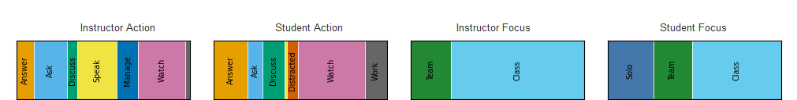
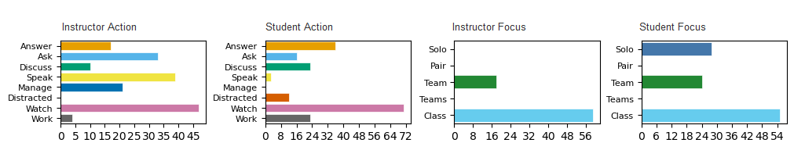
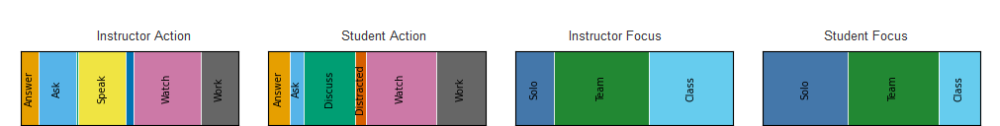
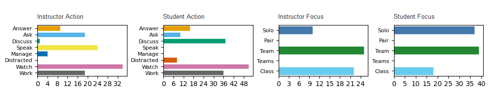

# Focus and Action of Students and Teachers Observation Protocol (FASTOP)

## What is FASTOP?

**FASTOP** is a classroom observation protocol intended to monitor the **focus** (e.g., solo, pair, team, or whole class) and **action** (e.g., discuss, speak/present, watch/listen, or distracted) of both **students** and **teachers** (instructors).

Many observation protocols combine group size and activity into a single code.
For example, COPUS has a code for "discuss clicker question in groups."
FASTOP records these separately: *who* is involved (focus) and *what* they are doing (action).
As a result, the same small set of codes works across many kinds of classes,
including lectures, labs, Peer Instruction, and POGIL.
One collaborator described FASTOP as an "assembly language" for observations:
it records lower-level practices that can be combined to describe higher-level practices.

## Who could use FASTOP?

- researchers who compare what happens in classes that use different pedagogies
- researchers who study how faithfully a pedagogy (e.g., POGIL) is implemented
- researchers who combine classroom observations with student or instructor surveys
- coaches, mentors, and instructors who want data on what students actually do in class

## What is in the FASTOP toolbox?

- Blank observation worksheets
  (see [How to conduct a FASTOP observation?](#how-to-conduct-a-fastop-observation) for the two kinds):
    - Student-level:
      [:material-file-pdf-box: printable PDF](img/FASTOP-student-level.pdf) or
      [:material-file-excel: spreadsheet](img/FASTOP-student-level.xlsx)
    - Class-level:
      [:material-file-pdf-box: printable PDF](img/FASTOP-class-level.pdf) or
      [:material-file-excel: spreadsheet](img/FASTOP-class-level.xlsx)
- The [:material-application: OPTIC App](https://optic.kussmaul.org),
  which supports FASTOP on a laptop or tablet and exports the data as a CSV file.
- Check out a [:material-database: sample datafile](). <!-- INCOMPLETE -->

## Public Data Release

FASTOP was developed as part of an NSF-funded project, "Exploring the Impact of POGIL on Student Engagement and Conceptual Understanding" ([DUE 2216454](https://www.nsf.gov/awardsearch/showAward?AWD_ID=2216454)).
All data we collected in Spring 2023 and Spring 2024 are available for other researchers to build on our work.
Please contact Chris Mayfield for access to the public data files.

## What are the FASTOP codes?

**Focus**  codes *who* students and teachers interact with,
while **Action** codes *what* students and teachers do.

Thus, most observations will have 1+ focus codes and 1+ action codes for both students and teachers.

 <!-- affects mkdocs but not VSCodium preview -->

|   Focus Code | Student Focus                         | Teacher Focus                    |
| -----------: | ------------------------------------- | ------------------------------   |
|         Solo | Students act alone.                   | Teacher with one student.        |
|         Pair | Students act in pairs.                | Teacher with pair of students.   |
|         Team | Students act in teams/groups (3-5).   | Teacher with student team.       |
|        Teams | Students act across or between teams. | Teacher with multiple teams.     |
|        Class | Students act as whole class.          | Teacher with whole class.        |

|  Action Code | Student / Teacher Action                                                 |
| -----------: | ------------------------------------------------------------------------ |
|       Answer | Answer question(s) posed by other(s).                                    |
|          Ask | Ask question(s) and wait for other(s) to answer.                         |
|      Discuss | Talk back and forth (more than one question and answer).                 |
|        Speak | Talk by one person with no interaction.                                  |
|       Manage | Pass out or collect papers, assign groups, take attendance.              |
|   Distracted | Distracted or off task.                                                  |
| Watch/Listen | Watch or listen (e.g., to lecture or presentation).                      |
|         Work | Write, take notes, work on computer, etc. (not ask, answer, or discuss). |

## How to conduct a FASTOP observation?

In our research, we used FASTOP in two kinds of observations:

- **Student-level observations** (live, in the classroom).
  The observer follows a sample of 8–12 specific students, plus the instructor.
  Every minute, the observer records the *action* codes for each student and for the instructor.
  Focus codes are not recorded.
- **Class-level observations** (from a video recording of the entire class).
  The observer codes the students as a group and the instructor.
  Every minute, the observer records both the *focus* and *action* codes for students and for the instructor.

In both kinds of observations:

- Record every code that applies during each one-minute interval.
  For example, a student might *Work* and *Discuss* in the same minute.
- Write a brief note whenever the class switches to a different activity
  (e.g., from lecture to teamwork), so the session can be split into segments later.
- Note anything unusual, such as technical problems or interruptions.

For student-level observations, we used the following IRB-approved procedure to protect student privacy:

1. Near the start of the term, students watched a short video describing the study
   and were invited to complete an informed consent form.
2. A colleague (not the instructor) collected the forms, so the instructor did not know which students consented.
3. The colleague used the list of consenting students and the instructor's team assignments
   to select the students to observe, and gave the observer photos of those students.

New observers should practice coding with classroom videos before observing a live class,
and compare their codes with an experienced observer.

## What are some tips for coding?

Some codes can be difficult to tell apart.
Here are some guidelines for common situations:

- **Ask, Answer, or Discuss?**
  If one person asks a question and another person answers, code *Ask* and *Answer*.
  If the conversation goes back and forth (more than one question and answer), code *Discuss*.
- **Speak or Ask?**
  If the teacher presents without interaction, code *Speak*.
  If the teacher poses a question and waits for students to respond, code *Ask*.
- **Work or Watch/Listen?**
  Students who listen to a lecture are *Watch/Listen* with focus *Class*.
  Students who take notes or work on their own are *Work* with focus *Solo*.
  If students do both during the same minute, code both.
- **Teacher walking around the room?**
  If the teacher monitors the class without talking to anyone, code *Watch/Listen* with focus *Class*.
  If the teacher stops to talk with a team, code *Discuss* (or *Ask* or *Answer*) with focus *Team*.
  If the teacher talks with two or more teams at the same time, use focus *Teams*.
- **Not sure?**
  Record the codes that seem closest, and write a note explaining what happened.

In data files, codes are prefixed with **S-** (student) or **I-** (instructor),
and *Watch/Listen* is abbreviated as *Watch* (e.g., `S-Watch`, `I-Speak`).

## What FASTOP codes are typical for various classroom activities?

This table shows the expected FASTOP codes for various classroom activities.
When a cell has multiple lines, each focus code is paired with the action code(s) on the same line.
For example, during a traditional lecture, some students watch/listen as a whole class,
some discuss in pairs, and some work alone or are distracted.

POGIL classes alternate between two modes:
teams work on an activity while the teacher monitors the class and interacts with teams,
and the teacher has teams "report out" their answers to the whole class.
Peer Instruction repeats a cycle of steps:
(a) the teacher poses a question, (b) students answer individually,
(c) the teacher presents the distribution of answers, (d) students discuss in pairs,
(e) students answer individually again, and (f) the teacher again presents the answers.

 <!-- affects mkdocs but not VSCodium preview -->

|                         Activity |        Teacher Focus | Teacher Action                 |           Student Focus | Student Action                                |
| -------------------------------: | -------------------: | ------------------------------ | ----------------------: | --------------------------------------------- |
|              Traditional Lecture |                Class | Speak                          | Class Pair Solo | Watch/Listen Discuss Work, Distracted |
|              Computer Laboratory | Class Solo, Pair | Watch/Listen Discuss, Work |           Solo Pair | Work Work, Discuss                        |
|                   POGIL Teamwork |       Class Team | Watch/Listen Discuss       |                    Team | Discuss, Work                                 |
|                 POGIL Report Out |                Class | Ask, Discuss                   |                   Class | Answer                                        |
|    Peer Instruction (a) question |                Class | Speak, Ask                     |                   Class | Watch/Listen                                  |
|      Peer Instruction (b) answer |                Class | Watch/Listen                   |                    Solo | Answer                                        |
|     Peer Instruction (c) results |                Class | Speak, Ask                     |                   Class | Watch/Listen                                  |
|     Peer Instruction (d) discuss |                Class | Watch/Listen                   |                    Pair | Discuss                                       |
|      Peer Instruction (e) answer |                Class | Ask                            |                    Solo | Answer                                        |
|     Peer Instruction (f) results |                Class | Speak                          |                   Class | Watch/Listen                                  |

See below for a table and plots of FASTOP codes from real classrooms.

## What can analysis of FASTOP data show?

This table summarizes preliminary results from our 2023 ASEE paper,
based on 44 class sessions in 10 sections of 3 courses, taught by 6 instructors at 2 institutions.
Each row is a FASTOP code, grouped into student and teacher *focus*, and student and teacher *action*.
Each column is a classroom activity: traditional lecture, interactive lecture, computer laboratory, POGIL team work, and POGIL report out.

To create the table, each observed session was split into segments based on the activity.
Observers often marked more than one code in the same minute, so each code was weighted by 1/*k*,
where *k* is the number of codes marked in that minute and category.
For example, if a student was coded as both *Work* and *Discuss* in one minute, each code counted as 1/2.
The weighted codes were then averaged across instructors and classes, so each block sums to 100%.
For clarity, values <10% have been replaced with an asterisk.

Thus, in a traditional lecture, the teacher mostly *speaks* to the whole *class*,
while roughly half of students *watch/listen* and the rest are *distracted* or *work*.
In contrast, during POGIL teamwork, the teacher *watches/listens* about 40% of the time, but also *discusses*, *asks*, and *manages*,
while students *discuss* and *work* more than half of the time.

 <!-- affects mkdocs but not VSCodium preview -->

|    Focus or Action | Code         | Trad. Lecture | Inter. Lecture | Comp. Lab | POGIL Team | POGIL Report |
| -----------------: | -----------: | ------------: | -------------: | --------: | ---------: | -----------: |
|  **Student Focus** | Solo         |            41 |              * |        61 |          * |            * |
|                    | Pair         |               |                |        33 |            |              |
|                    | Team         |               |             13 |         * |         88 |            * |
|                    | Teams        |               |                |           |          * |              |
|                    | Class        |            59 |             85 |         * |          * |           98 |
|                    |              |               |                |           |            |              |
|  **Teacher Focus** | Solo         |             * |                |        58 |         18 |              |
|                    | Pair         |               |                |        23 |          * |              |
|                    | Team         |             * |              * |         * |         53 |            * |
|                    | Teams        |               |                |         * |          * |              |
|                    | Class        |            96 |             91 |        13 |         21 |           92 |
|                    |              |               |                |           |            |              |
| **Student Action** | Answer       |             * |             22 |         * |         14 |           27 |
|                    | Ask          |             * |                |         * |          * |            * |
|                    | Discuss      |               |              * |        34 |         30 |            * |
|                    | Speak        |               |                |         * |          * |            * |
|                    | Manage       |               |                |           |          * |              |
|                    | Distracted   |            24 |             13 |         * |          * |           11 |
|                    | Watch/Listen |            51 |             40 |        16 |          * |           45 |
|                    | Work         |            20 |             18 |        35 |         28 |           14 |
|                    |              |               |                |           |            |              |
| **Teacher Action** | Answer       |             * |                |        17 |          * |            * |
|                    | Ask          |             * |             31 |         * |         13 |           41 |
|                    | Discuss      |               |              * |        50 |         16 |              |
|                    | Speak        |            87 |             46 |         * |          * |           46 |
|                    | Manage       |             * |              * |         * |         12 |            * |
|                    | Distracted   |               |                |           |          * |              |
|                    | Watch/Listen |               |             13 |        17 |         40 |            * |
|                    | Work         |               |                |           |          * |              |
|                    |              |               |                |           |            |              |

The plots below show FASTOP data from two individual class sessions (not averages); courses are anonymized.
For each session, the first plot shows the proportion of each code,
and the second plot shows the number of times each code was recorded.

Actions and focus for instructors and students during an interactive lecture session:

Actions and focus for instructors and students during a POGIL session:

## How does FASTOP differ from other observation protocols?

An observation protocol embodies decisions about what will be observed.
For example, the [*Classroom Observation Protocol for Undergraduate STEM (COPUS)*](http://www.cwsei.ubc.ca/resources/tools/copus.html) focuses on practices in *Peer Instruction*.
Similarly, the [*Observation Protocol for Teaching in Interactive Classrooms (OPTIC)*](https://pogil.org/pogil-tools/optic) focuses on practices in [*Process Oriented Guided Inquiry Learning (POGIL)*](https://pogil.org) and other forms of collaborative small-group learning.

We wanted to understand what actually happens in a variety of class sessions,
including lectures, lab activities, Peer Instruction, POGIL, etc.
Specifically, we wanted to analyze *what* students and teachers did (their **action**)
and *who* they interacted with (their **focus**).
For example, students could work with a team, a partner, or alone;
the instructor could speak to a single student, a team, or the whole class.

Thus, most COPUS and OPTIC codes map to multiple FASTOP codes.
Here is a [:material-map: draft mapping between OPTIC, COPUS, and FASTOP](fastop-mapping.md).

## How to learn more?

- FASTOP
    - C Kussmaul, PB Campbell, M Torres-Demas, C Mayfield, HH Hu (2023).
      [Introducing the Focus & Action of Students & Teachers Observation Protocol (FASTOP)](../research/2023/kussmaul-2023-fastop.md).
      *ASEE Annual Conference*. ([ASEE link](https://peer.asee.org/43856))
    - C Mayfield, C Kussmaul, HH Hu, PB Campbell (2024).
      [Exploring the impact of POGIL on student engagement](../research/2024/mayfield-2024-engage.md).
      *IUSE Summit*.
    - PB Campbell, C Kussmaul, C Mayfield, HH Hu, S Campbell-Mortman (2025).
      [Variation in engagement behaviors among student-centered pedagogies](../research/2025/campbell-2025-engage.md).
      *ACM Technical Symposium on Computer Science Education (SIGCSE TS)*. ([ACM link](https://doi.org/10.1145/3641554.3701894))
    - C Mayfield, PB Campbell, HH Hu, C Kussmaul (2025).
      [Exploring the impact of POGIL on student engagement](../research/2025/mayfield-2025-engage.md).
      *National Conference to Advance POGIL Practice (NCAPP)*.
- other observation protocols
    - RF Frey, U Halliday, S Radford, S Wachowski (2019).
      [Development of an observation protocol for teaching in interactive classrooms (OPTIC)](https://www.morressier.com/o/event/5fc642c603137aa525863c7c/article/5fc643a22d78d1fec4668269)
      *Abstracts of Papers of the American Chemical Society*.
    - MK Smith, FHM Jones, SL Gilbert, CE Wieman (2013).
      [The Classroom Observation Protocol for Undergraduate STEM (COPUS)](https://doi.org/10.1187/cbe.13-08-0154).
      *CBE - Life Sciences Education (LSE)* 12(4):618–627.
    - D Sawada, MD Piburn, E Judson, et al. (2002).
      [Measuring reform practices in science and mathematics classrooms: The Reformed Teaching Observation Protocol (RTOP)](https://doi.org/10.1111/j.1949-8594.2002.tb17883.x).
      *School Science & Mathematics* 102(6):245–253.
- comments or questions?
    - contact Clif Kussmaul or Pat Campbell
